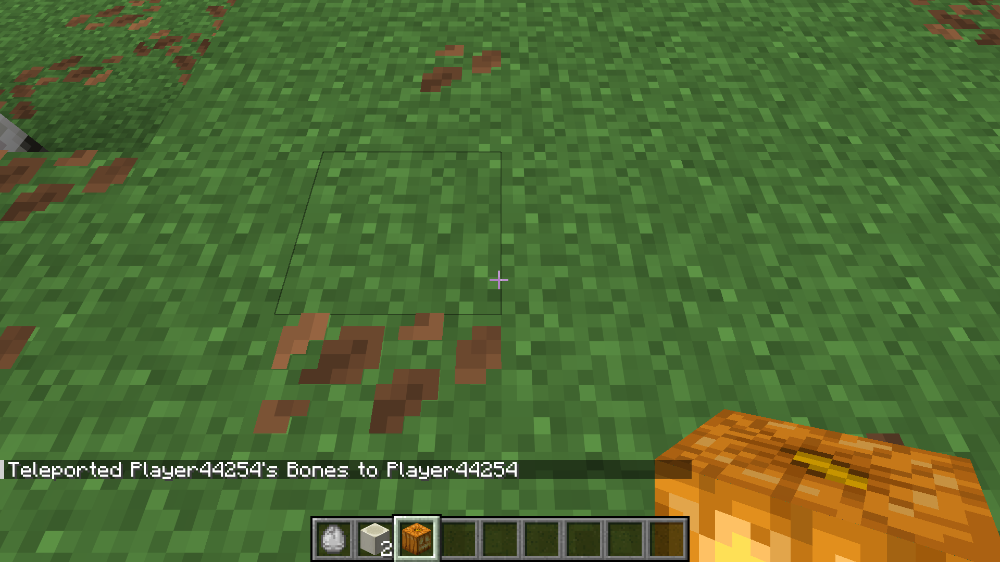
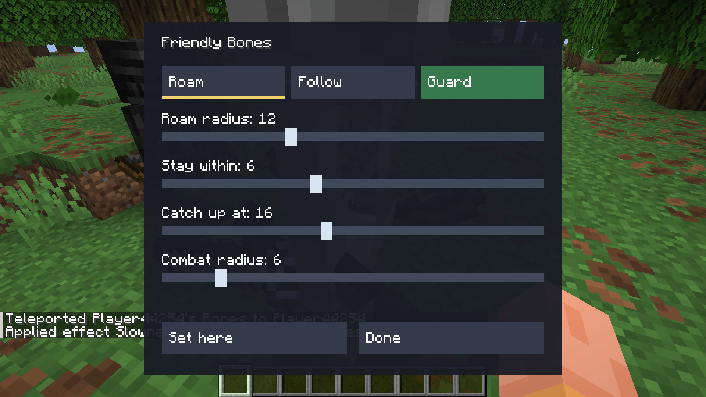

# Friendly Bones – Wiki

Friendly Bones adds two companion mobs to [Horizon](https://github.com/horizon-rust/horizon): a **Friendly Skeleton** and a **Friendly Wither Skeleton**. They can be summoned with a ritual or a spawn egg, claimed by a player, and told to roam, follow or guard. They fight with a bow and a sword, defend their owner, and are configured through a right-click menu.

This wiki covers the features, installation, configuration, development and the verification status. Start with [Installation](Installation.md) if you just want to play.

| Page | Contents |
| --- | --- |
| [Installation](Installation.md) | Requirements, installing the two package files, building |
| [Usage](Usage.md) | Rituals, spawn egg, claiming, the menu and controls |
| [Companion behaviour](Companion-Behaviour.md) | Roam, follow and guard, combat, alarm, friendly fire, peaceful mode |
| [Configuration](Configuration.md) | `friendlybones.json`, all keys, ranges and defaults |
| [Compatibility](Compatibility.md) | Horizon version pin, limitations and workarounds |
| [Architecture](Architecture.md) | Package layout, hook points, how the runtime is built into the game |
| [Development](Development.md) | Build, test and package workflow for contributors |
| [Validation](Validation.md) | What was tested in game and what is still open |
| [Porting notes](Porting-Notes.md) | Design decisions taken when porting from the Fabric original |

## Version

- Mod version: 0.2.0
- Target: Horizon nightly `2026-11-13-9f42064` (commit `9f42064c11efe7ef3e5ed2baad7ddc2a3b36eea0`), Minecraft 26.3
- Licence of the mod code: CC0-1.0. Horizon's sources keep their own MIT licence and are not part of the package.

## Screenshots

